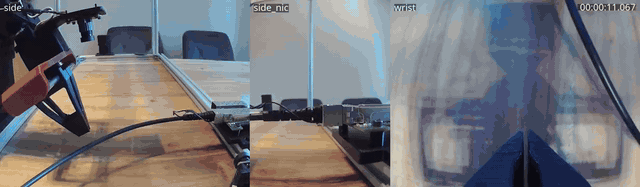
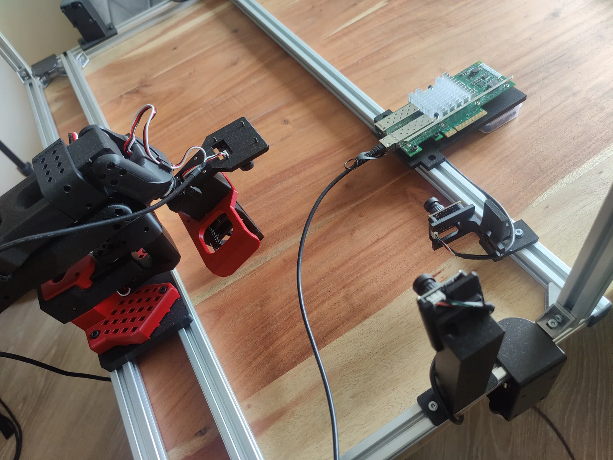
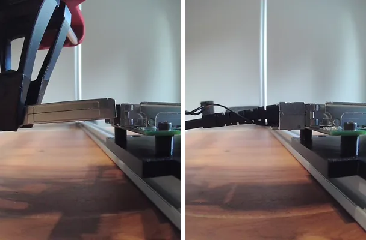

<h1>SO-101 SFP+ cable insertion</h1>

<b>A low-cost SO-101 arm learns a sub-millimetre task from demonstrations: plugging an SFP+ cable into a network card, with ACT, DAgger and inference on a remote GPU.</b>

Autonomous run as the policy sees it (side view, close-up of the port, wrist camera), 2× speed.

<a href="https://huggingface.co/datasets/luw84/so101_sfp_insertion">Dataset</a> ·
<a href="https://huggingface.co/luw84/act_so101_sfp_insertion">Policy</a> ·
<a href="guide/">Guide: setup, data, training</a>

## What I did

The task: pick up an SFP+ direct-attach cable and push it into the second port of a network card until it latches. An SFP+ module is 13.55 mm wide, its cage 14.00 mm, so the port leaves about 0.4 mm of play, and the module needs a push of up to 18 N to latch.

The robot is an SO-101, a hobby arm made of 3D-printed parts and Feetech STS3215 servos. Its gearboxes have around 0.9° of backlash per joint, and the servo firmware ignores errors below another 0.9°. At 20 to 30 cm from the shoulder, one degree moves the gripper by 3.5 to 5 mm. The arm's own positioning error is an order of magnitude larger than the clearance of the port, so moving to a taught pose cannot solve the task. The policy has to close the loop visually: watch module and port in a close-up camera, correct in small steps and use contact with the cage to slide the module in.

1. **Demonstrations.** About 2.5 hours of teleoperated data with the SO-101 leader arm: 166 demonstrations and 142 DAgger corrections. Every episode was rated and trimmed in a small browser-based [episode editor](tools/episode_editor/), and only good ones were kept.
2. **ACT.** [Action Chunking with Transformers](#how-act-works), trained from scratch on the demonstrations and fine-tuned after each round of corrections.
3. **DAgger** [[2, 3]](#references). The policy runs, I take over with the leader arm when it is about to fail, and the recovery plus the corrected sub-task is recorded as a new episode, as in RaC [[4]](#references). I extended LeRobot's DAgger loop so it works single-handed: one key to pause and resume, and rewinding the arm when the pause came too late, similar to Genie Centurion [[5]](#references).
4. **Remote inference.** Arms and cameras hang on a small computer without a usable GPU. The policy runs on a desktop GPU (13 ms per action chunk) and talks to the robot over the network through LeRobot's async inference.

The final policy grasps and inserts the cable in most runs and recovers from a bad grasp or a misaligned approach ([video](assets/insertions_robot_view.mp4): several insertions in a row, in one of them I shift the connector in the gripper on purpose). It still fails sometimes, see [Limitations](#limitations). I did not measure a success rate over a fixed protocol.

## Setup on the table

| | |
|---|---|
| Robot | SO-101 follower and leader ([LeRobot](https://github.com/huggingface/lerobot)), 6× Feetech STS3215 each, [parallel gripper](https://github.com/roboninecom/SO-ARM100-101-102-Parallel-Gripper) on the follower |
| Cameras | 3× USB camera (130° lens), 640×480 MJPG at 30 fps: a **side** view of the workspace, a **close-up of the ports** (`side_nic`, looking along the card at cable height), and a **wrist** camera on the gripper |
| Target | a network card with SFP+ ports screwed to a 20×20 aluminium profile, an SFP+ direct-attach cable lying in front of it |
| Compute | training and inference on an RTX 4070 Ti SUPER (16 GB, training uses ~6 GB). The robot side can be any small Linux computer |

<i>The port camera: the module approaching the port, and latched</i>

## How ACT works

ACT was introduced by Zhao et al. [[1]](#references) for exactly this kind of problem: precise manipulation with cheap, imprecise arms, learned from a few dozen demonstrations. Two ideas make it work:

- **Action chunking.** The policy predicts the next 100 actions at once (3.3 s), not one. A task of 1000 steps then needs about 20 decisions instead of 1000, so small errors compound much less.
- **A conditional VAE.** Demonstrations are not consistent: the same situation is solved slightly differently each time. During training, a second encoder compresses the "style" of the recorded chunk into a latent variable *z*, and the policy learns to produce the chunk from the observation *and* z. At test time z is zero, so the policy commits to one consistent motion instead of averaging between demonstrations.

Each camera image goes through a ResNet18, and every cell of its 15×20 feature map becomes a token. Together with the joint state (6 positions + 6 joint loads) and z, the transformer encoder sees 902 tokens. The decoder has one learned query per future time step and outputs 100 joint targets for the leader arm in one pass. 52 M parameters. The architecture is shown in Fig. 4 of the [ACT paper](https://arxiv.org/abs/2304.13705), in more detail in Fig. 11.

## What I learned

**The network matters more than expected.** Over Wi-Fi one raw observation (three images, 2.8 MB) took ~330 ms. Every chunk was planned for a pose the arm had already left, and the arm sometimes froze and jumped. A gigabit cable brought this down to 24 ms, and the motion became much smoother without any code change.

**Re-planning every step is worse on this arm.** The ACT paper re-plans at every step and averages the overlapping chunks (temporal ensembling). Here that was clearly worse: slower, stop-and-go motion. The ALOHA arms of the paper follow their targets almost exactly, so starting a new plan from the measured pose costs nothing. The SO-101 here lags its targets, and that gap between target and actual position is exactly what pushes the cable in. Frequent re-planning from the measured pose eats it away. Executing each chunk for about 50 steps works best.

**The policy uses the joint loads, and mostly one camera.** How much the predicted shoulder and elbow targets change during approach and insertion when single inputs are altered (400 frames):

| Input altered | change of the predicted targets |
|---|---|
| joint loads replaced | 5 to 6° |
| side camera blanked | 2 to 3° |
| wrist camera blanked | 7 to 10° |
| port close-up blanked | 16 to 21° |

For comparison, the policy's own error against the recorded actions is about 6°. The loads act mainly on the joints that push the cable in.

## Data, policy and guide

- **Dataset** on the Hugging Face Hub: [luw84/so101_sfp_insertion](https://huggingface.co/datasets/luw84/so101_sfp_insertion), the training data of the final policy: 111 episodes (58 demonstrations, 53 DAgger corrections), 45 min, three cameras, joint positions and loads. [Browse it online](https://huggingface.co/spaces/lerobot/visualize_dataset?path=/luw84/so101_sfp_insertion/episode_0).
- **Policy**: [luw84/act_so101_sfp_insertion](https://huggingface.co/luw84/act_so101_sfp_insertion), the final ACT checkpoint.
- **[Guide](guide/)**: hardware, installing LeRobot, calibration, downloading data and policy, training, running the policy and recording your own data.
- **[Episode editor](tools/episode_editor/)**: the browser-based editor used to rate, trim and delete episodes before training.

Everything is built on [LeRobot](https://github.com/huggingface/lerobot): recording, training, the robot drivers and the async inference.

## Limitations

- **Lighting.** The policy is sensitive to changes in light. Sunlight through the window changes brightness, shadows and reflections on the table over the day, and runs in different light were noticeably worse. Brightness and contrast augmentation does not cover moving shadows and reflections.
- **Teleoperation with the SO-101 is imprecise.** The leader uses the same hobby servos: its readings jump and drift, and backlash, dead zones and lag of the follower add up to millimetres. That limits the quality of both demonstrations and corrections. Better servos or a stiffer arm would help more than more data.
- **Occasional stalls during the final push**, with smaller and smaller corrections. ACT sees only the current frame, so it cannot tell "pushing and sliding in" from "pushing and jammed".
- **Under-voltage.** The follower's 7.4 V servos ran on a 5.4 V supply in this build. The policy learned the resulting lag, and a different supply would change the dynamics.
- **No success-rate benchmark** over a fixed set of start positions.

## Credits

[LeRobot](https://github.com/huggingface/lerobot) (Hugging Face, Apache-2.0): robot drivers, recording, ACT, async inference and the DAgger loop this project builds on, extended where needed (single-handed DAgger, joint loads in the state, fixes for async inference). SO-101 arm by [TheRobotStudio](https://github.com/TheRobotStudio/SO-ARM100).

## References

1. Tony Z. Zhao, Vikash Kumar, Sergey Levine, Chelsea Finn. *Learning Fine-Grained Bimanual Manipulation with Low-Cost Hardware.* RSS 2023. [arXiv:2304.13705](https://arxiv.org/abs/2304.13705)
2. Stéphane Ross, Geoffrey Gordon, Drew Bagnell. *A Reduction of Imitation Learning and Structured Prediction to No-Regret Online Learning.* AISTATS 2011. [arXiv:1011.0686](https://arxiv.org/abs/1011.0686)
3. Michael Kelly, Chelsea Sidrane, Katherine Driggs-Campbell, Mykel J. Kochenderfer. *HG-DAgger: Interactive Imitation Learning with Human Experts.* ICRA 2019. [arXiv:1810.02890](https://arxiv.org/abs/1810.02890)
4. Zheyuan Hu et al. *RaC: Robot Learning for Long-Horizon Tasks by Scaling Recovery and Correction.* 2025. [arXiv:2509.07953](https://arxiv.org/abs/2509.07953)
5. AgiBot. *Genie Centurion: Accelerating Scalable Real-World Robot Training with Human Rewind-and-Refine Guidance.* 2025. [arXiv:2505.18793](https://arxiv.org/abs/2505.18793)
