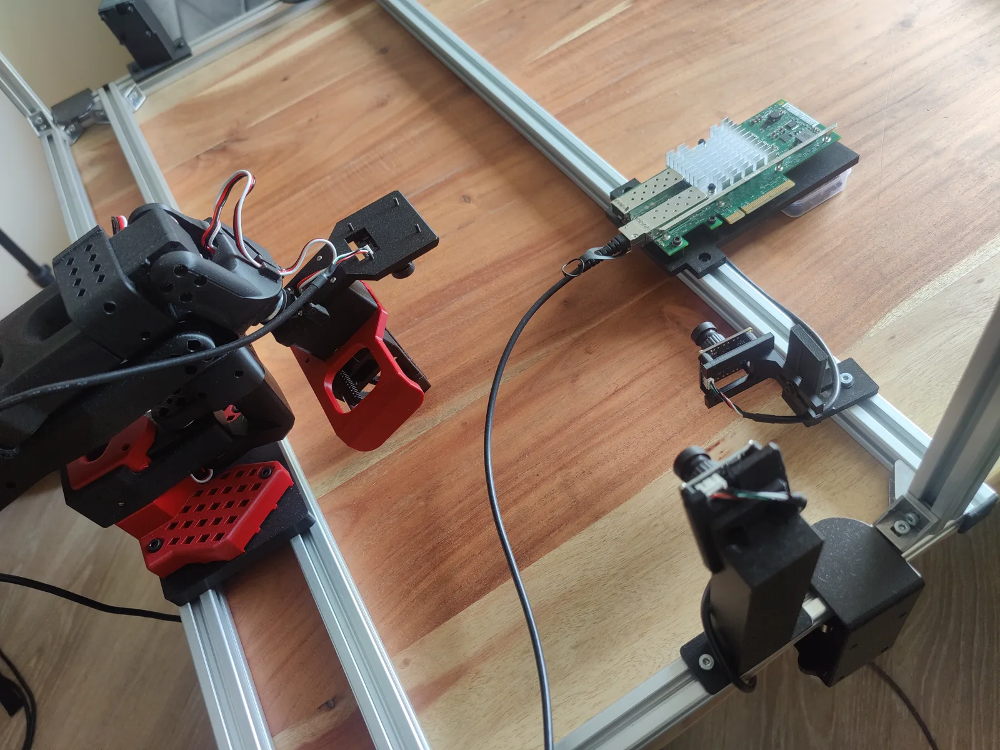

# Guide: setup, data and training

How to rebuild the setup, get the data and the policy from the Hugging Face Hub, train ACT yourself and run it on an SO-101. Everything uses standard [LeRobot](https://github.com/huggingface/lerobot) commands (this project used LeRobot 0.6.2).

- Dataset: [luw84/so101_sfp_insertion](https://huggingface.co/datasets/luw84/so101_sfp_insertion), 111 episodes (58 demonstrations, 53 DAgger corrections), 45 min
- Policy: [luw84/act_so101_sfp_insertion](https://huggingface.co/luw84/act_so101_sfp_insertion), the final ACT checkpoint
- Browse the episodes online: [LeRobot dataset visualizer](https://huggingface.co/spaces/lerobot/visualize_dataset?path=/luw84/so101_sfp_insertion/episode_0)

## 1. Hardware

| Part | Notes |
|---|---|
| SO-101 follower and leader | [SO-ARM100/101](https://github.com/TheRobotStudio/SO-ARM100), Feetech STS3215 servos |
| [Parallel gripper](https://github.com/roboninecom/SO-ARM100-101-102-Parallel-Gripper) | on the follower, instead of the standard jaw |
| 3 USB cameras | 640×480 MJPG at 30 fps, wide-angle lens. At most two per USB 2.0 controller: each reserves ~19 MB/s of bandwidth regardless of resolution |
| Network card with SFP+ ports and an SFP+ direct-attach cable | the card is screwed to a 20×20 aluminium profile, the cable lies in front of it |
| NVIDIA GPU | training uses ~6 GB at batch size 8 |

Camera placement, which the policy depends on:

- **side**: views the whole workspace from the side, mounted upside down (rotated 180°), overhead would also suffice or probably only the other 2
- **side_nic**: close-up looking along the network card at cable height, so the module and the ports are both in view, mounted sideways (rotated 90°, portrait 480×640)
- **wrist**: on the gripper, looking down at the jaws



## 2. Install LeRobot

```bash
python3.12 -m venv .venv && source .venv/bin/activate
pip install 'lerobot[feetech,dataset,training,async]'
```

## 3. Connect and calibrate the arms

```bash
lerobot-find-port                       # unplug and replug each arm to find its serial port
lerobot-find-cameras opencv             # find the camera indices or /dev/v4l/by-path names

lerobot-calibrate --robot.type=so101_follower --robot.port=/dev/ttyACM0 --robot.id=follower
lerobot-calibrate --teleop.type=so101_leader --teleop.port=/dev/ttyACM1 --teleop.id=leader

lerobot-teleoperate \
  --robot.type=so101_follower --robot.port=/dev/ttyACM0 --robot.id=follower \
  --teleop.type=so101_leader --teleop.port=/dev/ttyACM1 --teleop.id=leader
```

The camera configuration used by all commands below. Replace the three paths with your cameras:

```bash
CAMS='{ side: {type: opencv, index_or_path: /dev/video0, width: 640, height: 480, fps: 30, fourcc: MJPG, rotation: 180},
        side_nic: {type: opencv, index_or_path: /dev/video2, width: 480, height: 640, fps: 30, fourcc: MJPG, rotation: 90},
        wrist: {type: opencv, index_or_path: /dev/video4, width: 640, height: 480, fps: 30, fourcc: MJPG} }'
TASK="Insert the DAC cable into the second NIC slot"
```

## 4. Get the data and the policy

LeRobot downloads the dataset by itself when you train on it. To get both explicitly:

```bash
hf download luw84/so101_sfp_insertion --repo-type dataset \
  --local-dir ~/.cache/huggingface/lerobot/luw84/so101_sfp_insertion
hf download luw84/act_so101_sfp_insertion --local-dir outputs/act_so101_sfp_insertion
```

What is in the dataset:

- `observation.images.side`, `.side_nic`, `.wrist`: the three cameras
- `observation.state`: 6 joint positions + 6 joint loads (the servos' `Present_Load`)
- `action`: the 6 joint positions of the leader arm
- `meta/episode_labels.json`: per episode, whether it is a demonstration or a DAgger correction, and its rating (1 to 5)

## 5. Train ACT

The settings used for this project: batch size 8, 100k steps (about 5 hours on an RTX 4070 Ti SUPER) and photometric augmentation only. Crops and shifts are left out, because the cameras are fixed and the insertion depends on exact image positions.

```bash
lerobot-train \
  --dataset.repo_id=luw84/so101_sfp_insertion \
  --policy.type=act \
  --policy.device=cuda \
  --policy.push_to_hub=false \
  --batch_size=8 \
  --steps=100000 \
  --save_freq=10000 \
  --output_dir=outputs/train/act_so101_sfp_insertion \
  --dataset.image_transforms.enable=true \
  --dataset.image_transforms.tfs='{
    "brightness": {"weight": 1.0, "type": "ColorJitter", "kwargs": {"brightness": [0.7, 1.3]}},
    "contrast":   {"weight": 1.0, "type": "ColorJitter", "kwargs": {"contrast": [0.8, 1.2]}},
    "saturation": {"weight": 1.0, "type": "ColorJitter", "kwargs": {"saturation": [0.7, 1.3]}},
    "hue":        {"weight": 1.0, "type": "ColorJitter", "kwargs": {"hue": [-0.03, 0.03]}},
    "sharpness":  {"weight": 1.0, "type": "SharpnessJitter", "kwargs": {"sharpness": [0.6, 1.4]}}}'
```

To fine-tune instead, for example after adding new corrections, replace `--policy.type=act` with `--policy.path=<pretrained_model directory>`. 40k steps were enough here.

## 6. Run the policy on the robot

The policy reads the joint loads as part of its state. LeRobot's SO-101 driver reads only the joint positions, so running the policy needs the small driver extension from [this branch](https://github.com/luisluis8414/lerobot/tree/so101-dac-insertion), which adds `--robot.record_load=true`. Training (step 5) works with LeRobot as it is.

On a computer with the arms, the cameras and a GPU:

```bash
lerobot-rollout \
  --strategy.type=base \
  --policy.path=outputs/act_so101_sfp_insertion \
  --robot.type=so101_follower --robot.port=/dev/ttyACM0 --robot.id=follower \
  --robot.cameras="$CAMS" --robot.record_load=true \
  --task="$TASK" --duration=120
```

If the arms hang on a computer without a GPU, use LeRobot's async inference: the policy server runs on the GPU computer, the robot client next to the robot. Connect the two by cable: one observation is 2.8 MB, which takes ~25 ms over gigabit Ethernet and ~330 ms over Wi-Fi, and the late chunks over Wi-Fi made the arm freeze and jump.

```bash
# GPU computer
python -m lerobot.async_inference.policy_server --host=0.0.0.0 --port=8080 --fps=30

# robot computer
python -m lerobot.async_inference.robot_client \
  --robot.type=so101_follower --robot.port=/dev/ttyACM0 --robot.id=follower \
  --robot.cameras="$CAMS" --robot.record_load=true --task="$TASK" \
  --server_address=<gpu-computer>:8080 \
  --policy_type=act --pretrained_name_or_path=<policy directory on the GPU computer> \
  --policy_device=cuda --actions_per_chunk=100 --chunk_size_threshold=0.5 --fps=30
```

`--chunk_size_threshold=0.5` requests a new chunk when half of the current one is left. That worked best here: re-planning much more often made the arm slow and hesitant.

## 7. Record your own data

```bash
lerobot-record \
  --robot.type=so101_follower --robot.port=/dev/ttyACM0 --robot.id=follower \
  --robot.cameras="$CAMS" --robot.record_load=true \
  --teleop.type=so101_leader --teleop.port=/dev/ttyACM1 --teleop.id=leader \
  --dataset.repo_id=local/my_demos --dataset.single_task="$TASK" \
  --dataset.num_episodes=10 --dataset.episode_time_s=40 --dataset.reset_time_s=15 \
  --dataset.push_to_hub=false
```

Leave out `--robot.record_load=true` to record with stock LeRobot. The state then has only the 6 joint positions, and a policy trained on it runs with stock LeRobot as well.

Then rate, trim and delete episodes with the [episode editor](../tools/episode_editor/) and export only the good ones. For corrections on top of a trained policy, see LeRobot's [human-in-the-loop data collection](https://huggingface.co/docs/lerobot/hil_data_collection) (`lerobot-rollout --strategy.type=dagger`).
